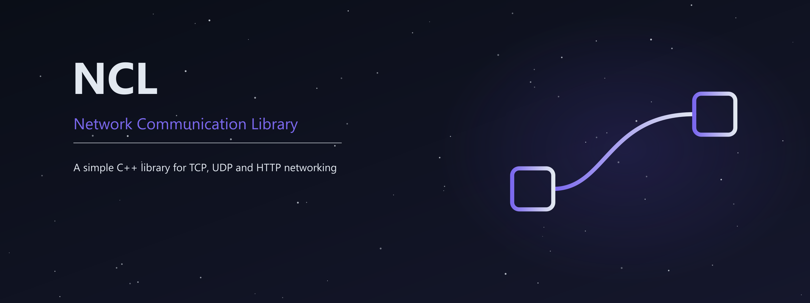

# NCL - Network Communication Library

NCL is a **header-only C++17 networking library for Windows and Linux**.
Use it for TCP connections, UDP packets, HTTP clients and HTTP/HTTPS API servers
with routes, path/query parameters, OpenAPI and Swagger UI.

Copy [NCL.hpp](NCL.hpp) into your project. It contains the entire library.
**HTTPS uses NCL's own TLS 1.2/1.3 implementation**, enabled with
`NCL_ENABLE_TLS`; application builds need no third-party TLS library.

## Start here

1. Read [Getting started](docs/GETTING_STARTED.md): create and run your first server and client.
2. Follow the [server tutorial](docs/SERVER.md): routes, validation, limits, Swagger, HTTPS and orderly shutdown.
3. Use the [API reference](docs/API.md) to look up every public type, field, method and default.
4. Read the [TLS guide](docs/TLS.md) before configuring certificates or using HTTPS beyond a local exercise.

> [!TIP]
> The documentation is in English. Examples use small programs and explain each
> step. A block marked **File** is a complete program: save it next to `NCL.hpp`,
> then compile it with the commands in its guide. Other code blocks are fragments.

## Documentation

| Guide | Contents |
| --- | --- |
| [Getting started](docs/GETTING_STARTED.md) | Installation, a small server/client pair, commands and expected results. |
| [Build and integration](docs/BUILDING.md) | MinGW, MSVC, Linux, CMake, TLS switches, multiple source files and developer checks. |
| [Server tutorial](docs/SERVER.md) | A practical server built step by step, request validation, response headers, HTTPS and graceful stopping. |
| [API reference](docs/API.md) | Complete public API, signatures, defaults, errors and ownership rules. |
| [TCP](docs/TCP.md) | Connections, raw bytes, NCL message framing, EOF, half-close, IPv6 and cancellation. |
| [UDP](docs/UDP.md) | Datagram send/receive, truncation, sender endpoints, IPv6 and cancellation. |
| [HTTP and HTTPS](docs/HTTP.md) | Detailed clients, routing, a notes CRUD API, Swagger, parsing and error behavior. |
| [Built-in TLS](docs/TLS.md) | Supported algorithms, certificate/key formats, trust, handshake behavior and security limits. |
| [Troubleshooting](docs/TROUBLESHOOTING.md) | Build errors, connectivity, routing, timeouts, certificates and browser behavior. |

## Choose a protocol

| Your application needs | Use |
| --- | --- |
| An ordered connection carrying a custom protocol | `Socket` and `ServerSocket`; [TCP guide](docs/TCP.md). |
| Independent packets with application-defined loss/retry behavior | `DatagramSocket`; [UDP guide](docs/UDP.md). |
| URLs and endpoints usable by browsers or ordinary HTTP tools | `HttpClient` and `HttpServer`; [HTTP guide](docs/HTTP.md). |
| HTTP with encrypted, authenticated transport | The HTTP API with built-in TLS; [HTTPS walkthrough](docs/SERVER.md#step-6-enable-https). |

NCL's `sendMessage`/`receiveMessage` format is a four-byte big-endian length
followed by payload bytes. Both peers must use that format. Raw TCP, UDP and
plain HTTP have no built-in encryption. UDP does not guarantee delivery/order.

## Status and limits

This folder contains **NCL 1.0.0-beta.1**. Supported platforms are
Windows and Linux, including Linux under WSL. macOS/BSD are outside this version.

The server handles **one connection at a time and one request per connection**.
It buffers complete bodies within configured caps. There is no worker pool,
HTTP/2 or HTTP/3, body streaming, automatic JSON object binding, database,
authentication system, certificate renewal, redirects, retries or decompression.
Socket timeouts exclude synchronous DNS; handlers cannot be forcibly interrupted.

> [!WARNING]
> The built-in TLS implementation is **experimental and has not received an
> independent cryptographic audit**. Its supported algorithms and certificate
> profile are deliberately limited; see [TLS limits](docs/TLS.md#current-limits).
> The tutorials document useful configurations and observable behavior; they do
> not establish that a server is production-hardened or free of security flaws.

Swagger UI loads its default assets from a pinned CDN. The API and OpenAPI JSON
work locally; [offline UI setup](docs/HTTP.md#swagger-assets-and-offline-operation)
requires serving the assets yourself.

## Project layout

| Path | Purpose |
| --- | --- |
| [NCL.hpp](NCL.hpp) | The only NCL file applications need to copy. |
| [README.md](README.md) | Project overview and documentation navigation. |
| [docs/](docs/) | All user tutorials and references. |
| [assets/](assets/) | Project artwork. |
| [test/](test/) | Development tests, verification records, TLS source fragments and generated builds. |
| [LICENSE](LICENSE) | MIT license. |

Recorded development checks include Windows GCC/MinGW and MSVC, Linux GCC under
WSL, independent HTTP/TLS peers and Linux sanitizer runs. See the
[TLS verification record](test/TLS_VERIFICA.md),
[socket record](test/VERIFICA.md), [HTTP record](test/HTTP_VERIFICA.md),
[server record](test/SERVER_VERIFICA.md) and
[current documentation review](test/DOCS_REFRESH_VERIFICA.md).
Historical records describe their own run and may show the previous file layout.

## License

NCL is released under the [MIT License](LICENSE).

Artificial intelligence was used to help create this project, including its
code and documentation.

Copyright © 2026 allekks_b.
